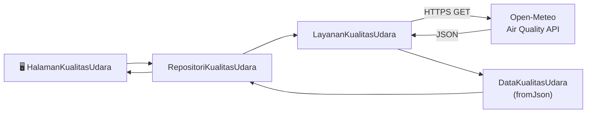

# Air Quality Monitor

Aplikasi Flutter untuk memantau kualitas udara secara real-time menggunakan [Open-Meteo Air Quality API](https://open-meteo.com/en/docs/air-quality-api). Data bersumber dari model atmosfer **CAMS (Copernicus Atmosphere Monitoring Service)** — bukan pembacaan langsung sensor.

---

## Fitur

- 🌍 **Pencarian berdasarkan koordinat** — masukkan latitude & longitude sembarang lokasi di dunia
- 📊 **US AQI** dengan kategori berwarna (Baik → Berbahaya) dan keterangan kesehatan
- 🇪🇺 **European AQI** ditampilkan berdampingan
- 🧪 **Pollutan lengkap** — PM2.5, PM10, O₃, NO₂, SO₂, CO beserta satuannya
- ✅ **Pengujian MockClient terintegrasi** — dapat dijalankan langsung dari dalam aplikasi tanpa koneksi internet
- ⚠️ **Penanganan error yang ramah** — pesan jelas untuk timeout, kesalahan jaringan, HTTP error, dan format data tidak valid

---

## Kategori US AQI

| Nilai | Kategori | Warna |
|-------|----------|-------|
| 0 – 50 | Baik | 🟢 Hijau |
| 51 – 100 | Sedang | 🟡 Kuning |
| 101 – 150 | Tidak sehat bagi kelompok sensitif | 🟠 Oranye |
| 151 – 200 | Tidak sehat | 🔴 Merah |
| 201 – 300 | Sangat tidak sehat | 🟣 Ungu |
| > 300 | Berbahaya | ⚫ Merah tua |

---

## Arsitektur

Proyek mengikuti pola **Service → Repository → UI** (tanpa state management eksternal):

```
lib/
├── main.dart                          # Entry point & inisialisasi http.Client
├── models/
│   └── data_kualitas_udara.dart       # Model data + deserialisasi JSON
├── services/
│   └── layanan_kualitas_udara.dart    # HTTP client ke Open-Meteo API
├── repositories/
│   └── repositori_kualitas_udara.dart # Validasi input + orkestrasi layanan
├── screens/
│   ├── halaman_kualitas_udara.dart    # Halaman utama + widget AQI/polutan
│   └── halaman_hasil_pengujian.dart   # Halaman hasil MockClient tests
└── tests/
    └── pengujian_repository.dart      # 17 skenario pengujian MockClient
```



---

## Prasyarat

| Perangkat lunak | Versi minimum |
|-----------------|---------------|
| Flutter SDK     | 3.x           |
| Dart SDK        | ^3.13.2       |

---

## Instalasi & Menjalankan

```bash
# Clone repositori
git clone <url-repo>
cd air_quality_monitor

# Pasang dependensi
flutter pub get

# Jalankan di perangkat/emulator/browser
flutter run
```

Untuk platform tertentu:

```bash
flutter run -d android   # Android
flutter run -d chrome    # Web (mode debug)
flutter run -d linux     # Linux desktop
```

---

## Pengujian

### Unit test (CLI)

```bash
flutter test
```

### Pengujian MockClient dari dalam aplikasi

Ketuk ikon **✔ (checklist)** di pojok kanan atas halaman utama untuk membuka halaman **Hasil Pengujian MockClient**. Terdapat **17 skenario pengujian** yang berjalan sepenuhnya offline menggunakan `MockClient`:

| # | Skenario |
|---|----------|
| 01 | JSON valid diparsing menjadi `DataKualitasUdara` |
| 02 | PM2.5, PM10, dan AQI terpetakan ke properti yang benar |
| 03 | Latitude & longitude dikirim lewat query parameter |
| 04 | Parameter `current` berisi 8 field polutan/AQI |
| 05 | Parameter `timezone=auto` dikirim |
| 06 | HTTP 404 menghasilkan `ApiException` |
| 07 | HTTP 500 menghasilkan `ApiException` |
| 08 | Body bukan JSON menghasilkan `FormatException` |
| 09 | Field penting hilang menghasilkan `FormatException` |
| 10 | Polutan opsional yang hilang menjadi `null` |
| 11 | Struktur JSON salah menghasilkan `FormatException` |
| 12 | Respons lambat menghasilkan `TimeoutException` |
| 13 | Nilai `int` dan `double` sama-sama dikonversi ke `double` |
| 14 | HTTP 400 membawa alasan dari API |
| 15 | Nilai non-numerik menghasilkan `FormatException` |
| 16 | Kegagalan jaringan menghasilkan `JaringanException` |
| 17 | Satuan mengikuti `current_units` dari respons |

---

## API yang Digunakan

**Open-Meteo Air Quality API** — gratis, tanpa API key.

Contoh request yang dihasilkan aplikasi:

```
GET https://air-quality-api.open-meteo.com/v1/air-quality
  ?latitude=-0.5022
  &longitude=117.1536
  &current=pm2_5,pm10,us_aqi,european_aqi,ozone,nitrogen_dioxide,sulphur_dioxide,carbon_monoxide
  &timezone=auto
```

> **Catatan:** Koordinat yang dikembalikan API (`latitude`, `longitude`) adalah titik pusat grid model, bukan koordinat persis yang diminta. Di luar Eropa, resolusi model global sekitar **45 km**.

---

## Dependensi

| Package | Kegunaan |
|---------|----------|
| [`http`](https://pub.dev/packages/http) `^1.6.0` | HTTP client untuk memanggil Open-Meteo API |
| [`flutter_lints`](https://pub.dev/packages/flutter_lints) `^6.0.0` | Aturan linting Flutter (dev) |
| [`flutter_test`](https://api.flutter.dev/flutter/flutter_test/flutter_test-library.html) | Framework pengujian Flutter (dev) |

---

## Struktur Penanganan Error

```
Permintaan gagal
├── TimeoutException    → "Permintaan melebihi batas waktu…"
├── JaringanException   → "Tidak dapat terhubung ke server…"
│   └── (di Web: ditambah petunjuk CORS)
├── ApiException
│   ├── HTTP 400        → "Permintaan ditolak server…"
│   └── HTTP 5xx        → "Server Open-Meteo sedang bermasalah…"
└── FormatException     → "Data dari server tidak sesuai format…"
```

---

## Lisensi

Proyek ini dibuat untuk keperluan pembelajaran. Silakan gunakan dan modifikasi sesuai kebutuhan.
